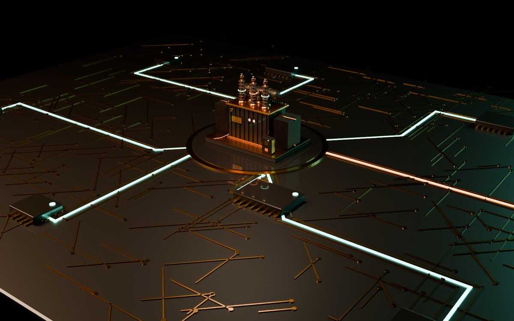

# Interface Lab

Concept prototypes directed by Cesar Navarro. October 2026 concept work. He set the problem, the user, and the flow. AI-assisted build (Claude, Cursor).

Every piece here runs in the browser. Click, drag, approve, undo, and see what happens. All demo data is fictional.

| Piece | Label | What it shows |
| --- | --- | --- |
| [Valley Grid Operations](valley-grid/) | Concept · October 2026 | Investigate an equipment alert, from alert to crew sent ([case study](valley-grid/CASE-STUDY.md)). Concept direction. AI-assisted build (Claude, Cursor). The 3D scene runs in the browser and loads when you ask, so the alert panel is ready first |
| [Lab UI](lab-ui/) | Concept · October 2026 | The shared system behind the pieces: tokens with checked contrast, components taken from real use, and an accessibility audit. A Figma mirror is planned and is not built. No 3D |
| [Relay](relay/) | Concept · October 2026 | Speed-to-lead builder: a test lead moves through a flow that texts, qualifies, books, and alerts the owner, in English and Spanish. Fictional business and leads |
| [Signed → Live](signed/) | Concept · October 2026 | A phone flow for a fictional agency client, from a signed contract to a first ad, in English and Spanish, plus an agency view of who is stuck. Reminders stay on the page. Not Berth |
| [Keel Account Health](keel/) | Concept · October 2026 | A customer-success book: health from five visible signals, filters, a confirmed next step, tasks, undo, and a sample CSV. Fictional accounts |
| [Berth Onboarding](berth/) | Concept · October 2026 | A new-account checklist: blocked steps, who needs to act next, and a reminder that stays on the page. Nothing is emailed |
| [Linden Client Book](linden/) | Concept · October 2026 | A daily client list for a fictional boutique: who needs a follow-up and why, what they like, and a draft that never sends |
| [Kestrel Agent Console](kestrel/) | Concept · October 2026 | An AI agent handles a refund ticket. A person approves the money and the reply. Fictional customer and charges |
| [Harbor CRM Copilot](harbor-copilot/) | Concept · October 2026 | Bulk deal cleanup shown as diffs in the table, with conflicts and undo. Fictional deals |
| [Decision OS](decision-os/) | Concept · October 2026 | Import a fictional sample export and see where everything stands. Not connected to an account. Not a shipped product |
| [Flare](flare/) | Concept · October 2026 | Ad account copilot for a fictional agency and shop: when cost per lead spikes, the page shows the evidence, separates diagnosis from action, and does not move budget without approval. Made-up numbers. No 3D |
| [Tidewell Revenue Pulse](tidewell/) | Concept · October 2026 | Still in the repo at `tidewell/`. Not on the hub. Why a fictional month of revenue changed, down to four accounts and a win-back task. Not a finance claim |

Each page has its own case study at the bottom, and a States menu to see empty, loading, and error states.

## How these were made

**Role:** Concept direction.

**Tools:** AI-assisted build (Claude, Cursor).

Cesar Navarro set the problem, user, flow, and design decisions, and reviewed every state. The code and the Valley Grid 3D scene were generated with those tools under his direction. He did not model the scene by hand. Three.js runs only on Valley Grid, and only after you load the model. No build step. Each piece is one file. Lab UI is the shared system extracted from the pieces. It is not a Figma library.

## Everything works

Every button, filter, and form on every piece does something with demo data:

- Approvals, applied changes, tasks, imports, and flow edits are saved in the browser (localStorage keys start with `il-`). Each piece has a **Reset demo** or **Start over** control to clear them.
- Undo is offered after every change that matters.
- Export buttons download CSV files. Copy buttons write to the clipboard.
- Search, filters, and sort re-render right away and show a "No matches" message when nothing fits.
- Forms check their fields and show the error next to the field.

## Site address

Link previews (Open Graph and Twitter) use `https://canaca.github.io/interface-lab/`. If the repo or GitHub username changes, update `canaca` and `/interface-lab/` in the meta tags of each page. The preview image is `og-image.png` (1200×630) and the icon is `favicon.svg`.

This repository is a draft candidate. Publishing to GitHub Pages is Cesar's decision.

## Contact form setup

The hub has a step-by-step contact form. It works on GitHub Pages with no server.

1. Make a free form at formspree.io (or any service that accepts JSON posts).
2. In `index.html`, find the config block near the bottom and paste the form URL into `FORM_ENDPOINT`.
3. Optional: paste a booking link (like Calendly) into `BOOKING_URL`. Strong-fit leads see a "Book a call" button.

If `FORM_ENDPOINT` is empty or the post fails, the form opens the visitor's email app with their answers filled in, addressed to cnavarro.business@gmail.com.

## Run it

Open `index.html`, or turn on GitHub Pages (Settings > Pages > Deploy from branch > main) only after Cesar approves a publish.

All data in these demos is fictional.

Contact: cnavarro.business@gmail.com
