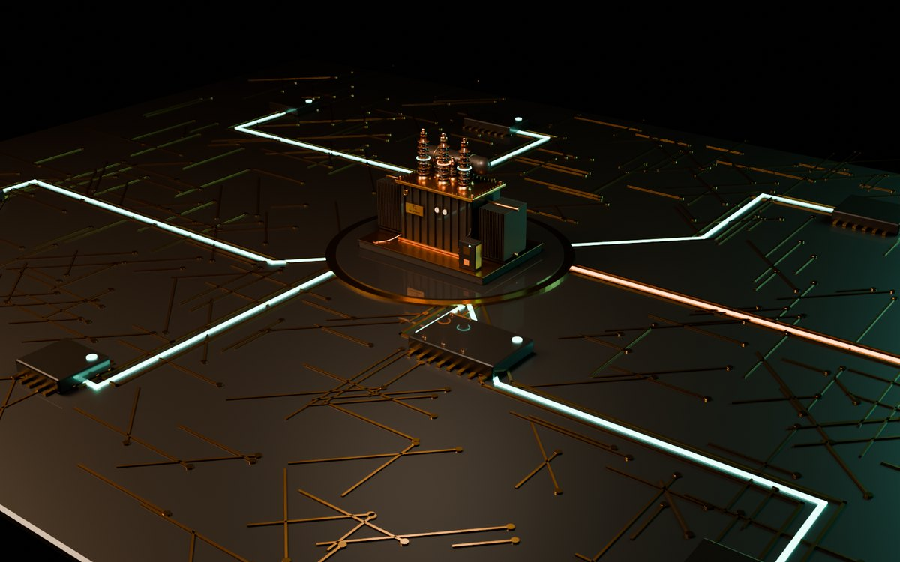

# Interface Lab

Live, working interface concepts for AI and data products, directed by Cesar Navarro.

Every piece here runs in the browser. Click, drag, approve, undo, and see what happens.

| Piece | Label | What it shows |
| --- | --- | --- |
| [Valley Grid Operations](valley-grid/) | Concept | Investigate an equipment alert on a live 3D transformer, from alert to crew sent ([case study](valley-grid/CASE-STUDY.md)) |
| [Kestrel Agent Console](kestrel/) | Concept | An AI agent handles a refund ticket. A person approves the money and the reply. |
| [Decision OS](decision-os/) | Working build | Import a sample ChatGPT export and see where everything stands. Demo uses fictional data. |
| [Harbor CRM Copilot](harbor-copilot/) | Concept | Bulk deal cleanup from AI, shown as diffs in the table, with conflicts and undo |
| [Tidewell Revenue Pulse](tidewell/) | Concept | Why June revenue fell, down to the four accounts and a win-back task |
| [Relay](relay/) | Concept | Speed-to-lead builder: texts new Meta leads in under a minute, AI qualifies, books and alerts the owner, in English and Spanish |

Each page has its own case study at the bottom, and a States menu to see empty, loading, and error states.

## Built with

Plain HTML, CSS, and JavaScript. Three.js for 3D, used only on Valley Grid, where the 3D model is the interface. No build step. Each piece is one file.

## How these were made

These are concepts directed by Cesar Navarro and built with AI tools (Claude, Cursor) under his direction: he set the problem, user, flow and design decisions, and reviewed every state. The code and 3D assets were generated with those tools.

## Everything works

Every button, filter and form on every piece does something real with demo data:

- Approvals, applied changes, tasks, imports and flow edits are saved in your browser (localStorage keys start with `il-`). Each piece has a **Reset demo** or **Start over** control to clear them.
- Undo is offered after every change that matters (approve, send, apply, remove, clear), in the toast and in the page.
- Export buttons download real CSV files. Copy buttons write to the clipboard.
- Search, filters and sort re-render right away and show a "No matches" message when nothing fits.
- Forms check their fields and show the error next to the field.

Every control on every page was checked with an automated click-through audit before publishing.

## Site address

Link previews (Open Graph and Twitter) use the full web address of the site, `https://canaca.github.io/interface-lab/`. If the repo or GitHub username changes, update `canaca` and `/interface-lab/` in the meta tags of each page. The preview image is `og-image.png` (1200×630) and the icon is `favicon.svg`.

## Contact form setup

The hub has a step-by-step contact form. It works on GitHub Pages with no server.

1. Make a free form at formspree.io (or any service that accepts JSON posts).
2. In `index.html`, find the config block near the bottom and paste the form URL into `FORM_ENDPOINT`.
3. Optional: paste a booking link (like Calendly) into `BOOKING_URL`. Strong-fit leads see a "Book a call" button.

If `FORM_ENDPOINT` is empty or the post fails, the form opens the visitor's email app with their answers filled in, addressed to cnavarro.business@gmail.com.

## Run it

Open `index.html`, or turn on GitHub Pages (Settings > Pages > Deploy from branch > main).

All data in these demos is fictional.

Contact: cnavarro.business@gmail.com
